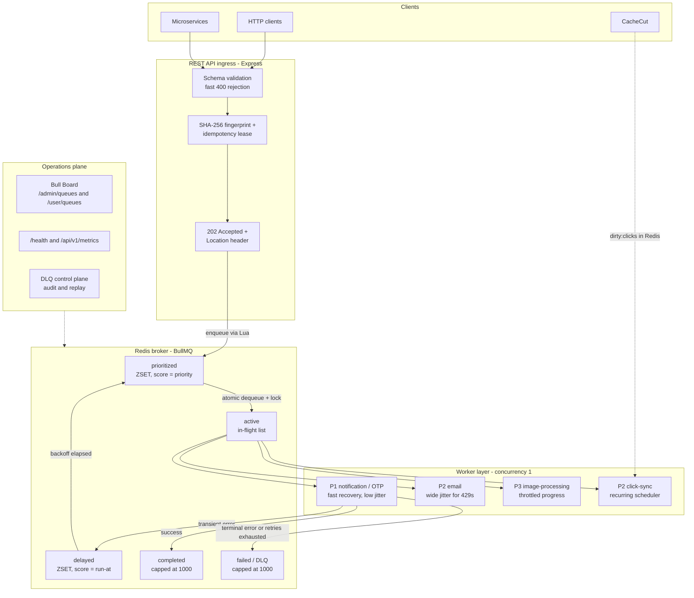
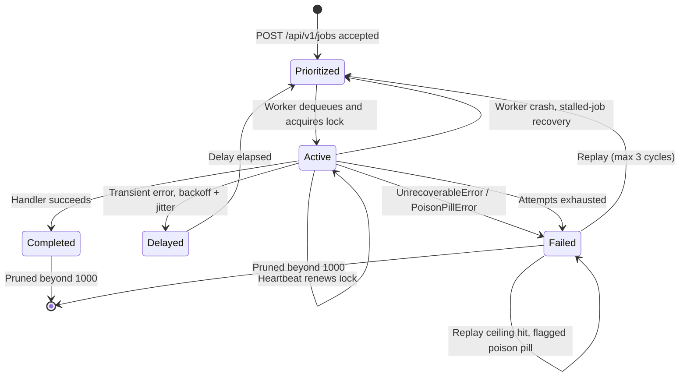
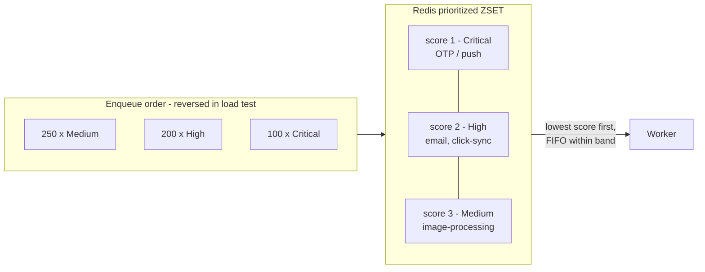
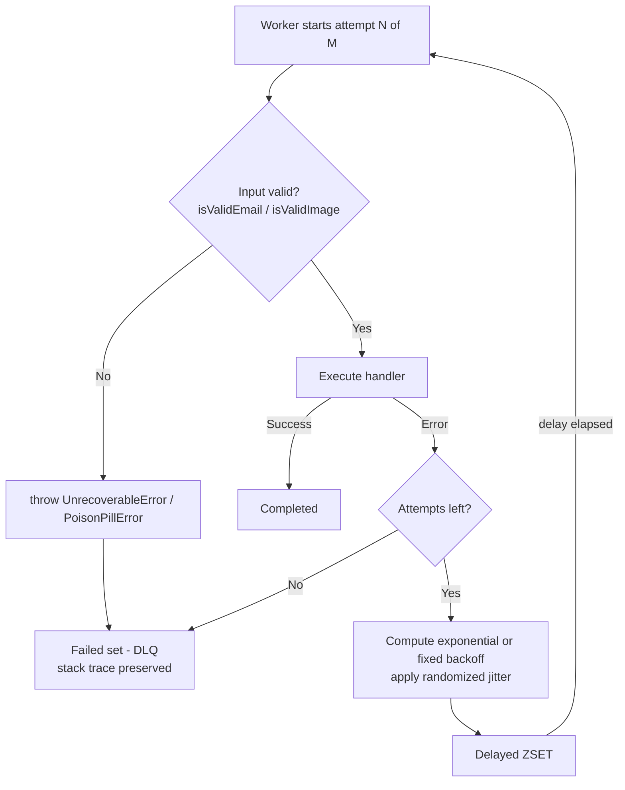
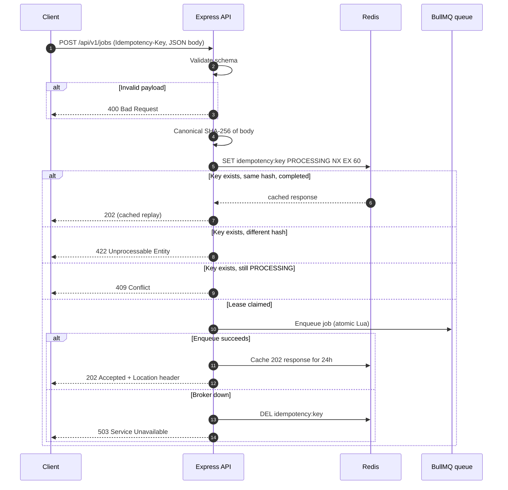
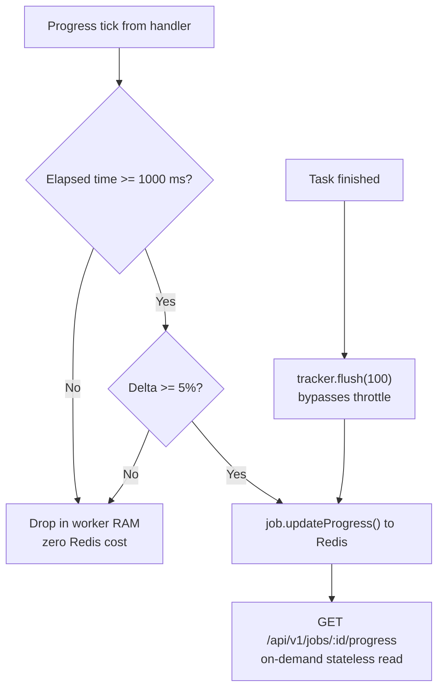
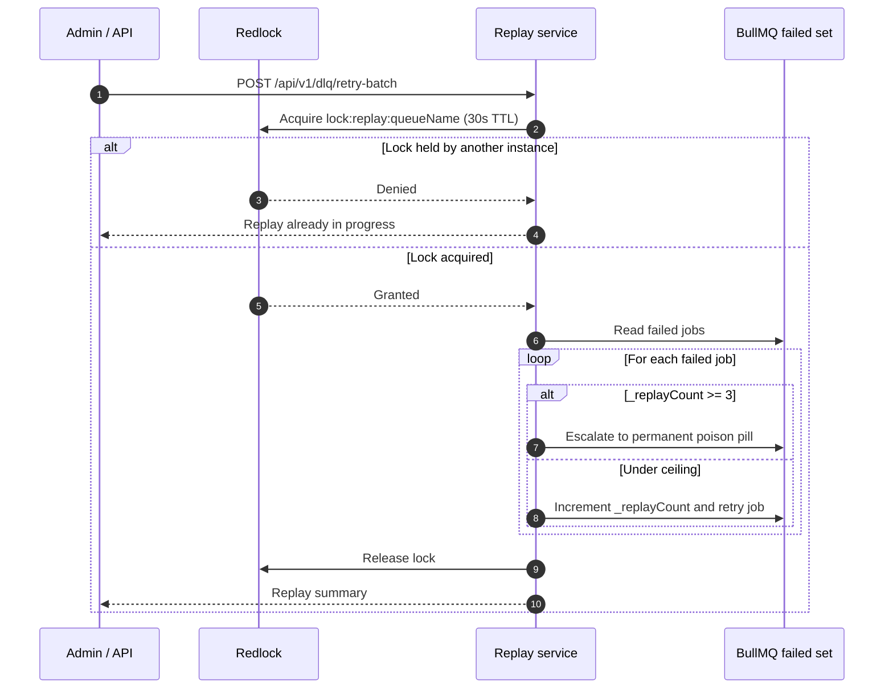
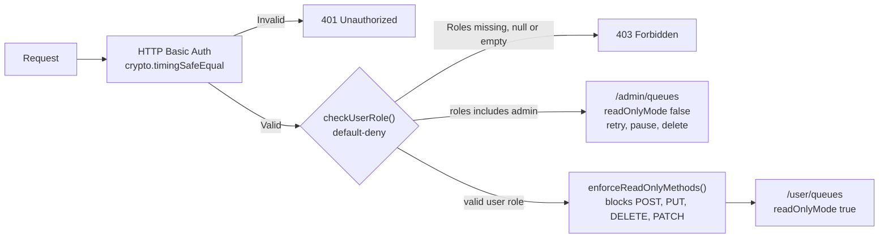
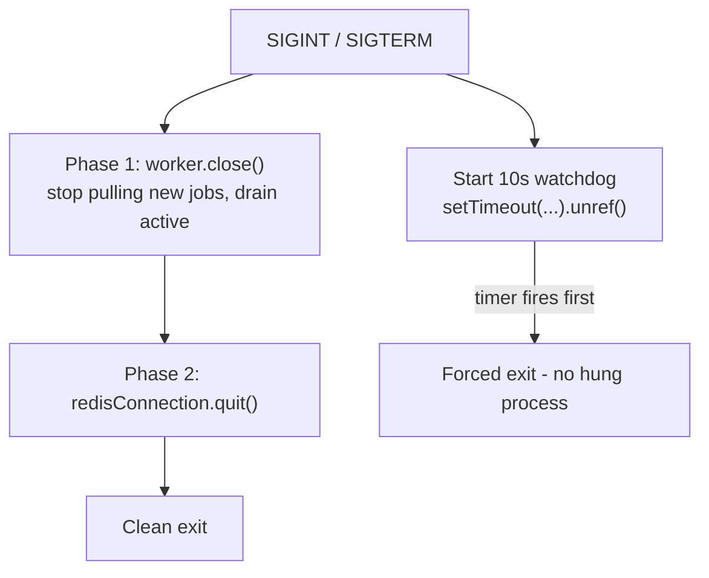
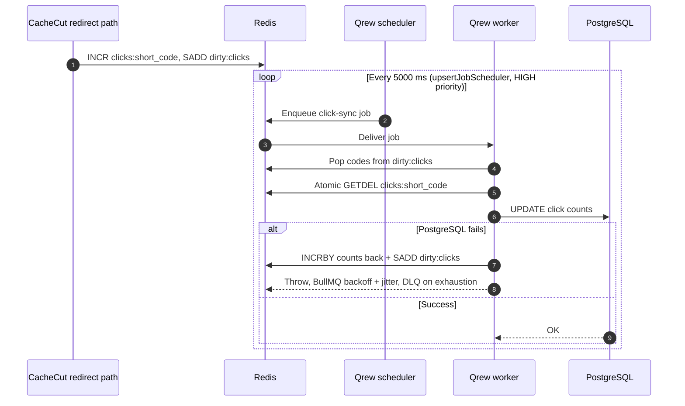

# Qrew

A production-oriented distributed asynchronous job queue engine built with **TypeScript, BullMQ, Redis and Express**.

[](https://qrew.onrender.com)
[](https://qrew.onrender.com/user/queues)
[](./docker-compose.yml)

> ⏳ *Note: First load may take 30–60s while the Render free-tier instance wakes up.*

### 🌐 Live Portfolio Links
- **Interactive Sandbox & Dispatcher**: [https://qrew.onrender.com](https://qrew.onrender.com)
- **Viewer Dashboard (Read-Only)**: [https://qrew.onrender.com/user/queues](https://qrew.onrender.com/user/queues)
- **Admin Console (Mutating & DLQ Replay)**: [https://qrew.onrender.com/admin/queues](https://qrew.onrender.com/admin/queues)
- **Broker Health Endpoint**: [https://qrew.onrender.com/health](https://qrew.onrender.com/health)

**Demo Credentials (HTTP Basic Auth):**
- **Viewer**: `viewer` / `demo_viewer_pass`
- **Admin**: `admin` / `demo_admin_pass`

> 🛡️ **Public Demo Security & Blast Radius**: Public demo credentials run against isolated sandbox instances. Mutations are strictly bounded to demo queue states (admins can clear, retry, or pause demo jobs, but cannot touch host code or cloud infrastructure). Ingress is rate-limited (60 req/min, 10kb body limit), worker jobs are safe simulations with payload type allowlists, and an automated background watchdog auto-resumes the queue if paused. See [ADR-016](./ADR.md#adr-016-public-demo-threat-modeling-blast-radius-containment--self-healing-watchdogs).

---

Qrew decouples synchronous API traffic from compute-intensive or rate-limited work such as transactional OTPs, bulk emails, image processing and database write-behind syncs. It ships with strict priority scheduling, tiered retries with jitter, poison-pill isolation, SHA-256 idempotency at the ingress layer, throttled progress telemetry, a native dead-letter queue with Redlock-protected replay, role-partitioned Bull Board dashboards, and a documented failure-mode matrix.

Its first production workload is the click-persistence pipeline of [CacheCut](https://github.com/makx-dev/CacheCut), a high-throughput URL shortener.

> Full design rationale, alternatives considered and trade-offs for every decision live in [`ADR.md`](./ADR.md).

---

## Table of contents

- [Features](#features)
- [Architecture](#architecture)
  - [System overview](#system-overview)
  - [Job state lifecycle](#job-state-lifecycle)
  - [Priority scheduling](#priority-scheduling)
  - [Retry and error handling](#retry-and-error-handling)
  - [Idempotent ingress](#idempotent-ingress)
  - [Throttled progress telemetry](#throttled-progress-telemetry)
  - [Dead-letter queue and Redlock replay](#dead-letter-queue-and-redlock-replay)
  - [Observability and RBAC](#observability-and-rbac)
  - [Graceful shutdown](#graceful-shutdown)
  - [CacheCut click-sync consumer](#cachecut-click-sync-consumer)
- [Tech stack](#tech-stack)
- [Getting started](#getting-started)
- [API reference](#api-reference)
- [Job types](#job-types)
- [Key design decisions](#key-design-decisions)
- [Failure modes and mitigations](#failure-modes-and-mitigations)
- [Verification and load-test results](#verification-and-load-test-results)
- [Scaling roadmap](#scaling-roadmap)
- [Project structure](#project-structure)
- [License](#license)

---

## Features

- **Strict priority scheduling** via Redis Sorted Sets (`ZSET`). Critical jobs (OTP, password reset) always preempt lower tiers.
- **Tiered exponential backoff with jitter**, tuned per job SLA, to avoid thundering-herd collisions on downstream rate limits.
- **Terminal vs. transient error handling.** Deterministic failures throw `UnrecoverableError` and skip the remaining retry budget (poison-pill quarantine).
- **Edge-decoupled REST ingress** with synchronous schema validation, SHA-256 canonical body fingerprinting and Redis-backed idempotency.
- **Dual-gate throttled progress** (time and percentage gates) with a guaranteed terminal flush to 100%.
- **Native dead-letter queue** with capped retention, a replay-count ceiling and Redlock-serialized single/batch replay.
- **Two-phase graceful shutdown** that drains in-flight work before closing Redis connections.
- **Multi-role Bull Board dashboards**: a read-only user view and a full-control admin view, behind default-deny RBAC.
- **Health and metrics endpoints** that probe broker readiness and expose O(1) queue counts.
- **Native recurring scheduler** (BullMQ v6 `upsertJobScheduler`) used for CacheCut click-sync.
- **Bounded memory via circular retention**: Completed jobs are ring-buffered (`removeOnComplete: 100`) to strictly protect Redis RAM, decoupling transient broker storage from lifetime metrics (see [ADR-015](./ADR.md#adr-015-capped-job-retention-redis-memory-bounds--production-metrics-decoupling)).
- **Empirical verification harnesses** for priority, retries, progress, DLQ, API contracts, monitoring auth and click-sync.

---

## Architecture

### System overview



### Job state lifecycle



1. **Ingest.** The API validates the payload, claims the idempotency key, enqueues into the prioritized `ZSET` through an atomic Lua script and returns `202 Accepted`.
2. **Dequeue and lock.** A worker atomically moves the highest-priority job to `active` and acquires an exclusive lock token.
3. **Execute and heartbeat.** The worker renews the lock periodically. If it crashes, the stalled-job monitor returns the job to `prioritized`.
4. **Resolve.**
   - *Success:* moved to `completed` (capped retention).
   - *Transient error:* scheduled into the `delayed` set with exponential backoff and jitter.
   - *Terminal or poison-pill error:* short-circuits remaining retries and lands in `failed` (the DLQ).

### Priority scheduling

BullMQ maps priority to a Redis `ZSET` score of `(priority << 40) | seq`. Lower scores dequeue first in O(log N), and the sequence component keeps insertion order within a band.



### Retry and error handling

Each job type has its own retry profile, chosen to match its downstream SLA.

| Job type | Attempts | Backoff | Base delay | Jitter | Rationale |
| :--- | :---: | :--- | :---: | :---: | :--- |
| `notification` | 3 | Exponential | 500 ms | 20% | Fast OTP recovery |
| `email` | 5 | Exponential | 2,000 ms | 50% | Absorb downstream HTTP 429 storms |
| `image-processing` | 3 | Fixed | 10,000 ms | 30% | Ride out transient CDN timeouts |



Retry verification uses window assertions instead of brittle monotonic checks, so overlapping jitter bands do not cause flaky CI:

```
window_i = [ nominal * (1 - jitter) - buffer,  nominal + buffer ]
```

### Idempotent ingress



### Throttled progress telemetry

Calling `job.updateProgress()` on every sub-chunk runs a Lua script and a Pub/Sub broadcast each time, which can starve BullMQ's lock-extension heartbeats and cause false stalled-job recoveries. Qrew filters ticks in worker memory instead.



Sub-second atomic jobs (`notification`, `email`) skip progress writes entirely; their state transitions are sufficient.

### Dead-letter queue and Redlock replay

Failed jobs stay in BullMQ's native `failed` set (capped at 1,000) rather than a secondary queue, so job IDs and provenance are preserved.



### Observability and RBAC



Bull Board's `readOnlyMode` only hides buttons, so the HTTP-method guard in front of `/user/queues` is what actually prevents `curl` or DevTools mutations.

### Graceful shutdown



Run containers with a termination grace period of at least 15 seconds.

### CacheCut click-sync consumer

CacheCut keeps only a sub-millisecond in-memory-to-Redis counter flush on its redirect path. All PostgreSQL persistence is offloaded to a Qrew recurring job.



The recurring job uses `removeOnComplete: 100` and `removeOnFail: 500` so empty 5-second ticks do not fill Redis. The trade-off is a bounded 5-second eventual-consistency window for analytics in exchange for full redirect isolation and no click loss.

---

## Tech stack

| Layer | Technology |
| :--- | :--- |
| Runtime | Node.js 20+, TypeScript |
| Queue engine | BullMQ (v6 scheduler API) |
| Broker | Redis 7+ via `ioredis` |
| API | Express 5 |
| Dashboards | Bull Board |
| Distributed locking | Redlock |
| Containerization | Docker |

---

## Getting started

### Prerequisites

- Node.js 20+
- Redis 7+ (local or Docker)

### Setup

```bash
git clone https://github.com/makx-dev/Qrew.git
cd Qrew
npm install
```

Create a `.env` file (never commit secrets):

```env
REDIS_HOST=localhost
REDIS_PORT=6379
# Optional: monitoring credentials, API port, etc.
```

Start Redis, for example with Docker:

```bash
docker run -d --name qrew-redis -p 6379:6379 redis:7
```

Qrew enforces `maxmemory-policy noeviction` on startup through its `ensureRedisNoEviction()` helper, so jobs are never silently evicted.

### Run

```bash
# Development
npm run producer:dev   # producer / enqueue side
npm run worker:dev     # worker
npm run api:start      # REST API + Bull Board dashboards

# Production-style
npm run build
npm run producer:start
npm run worker:start
```

### Verification scripts

```bash
npm run test:priority    # priority + FIFO ordering under load
npm run test:retry       # exponential backoff + jitter windows
npm run test:progress    # throttled progress telemetry
npm run test:dlq         # dead-letter queue + replay
npm run test:api         # API contract + idempotency
npm run test:monitoring  # dashboard + auth paths
```

---

## API reference

Routes are registered in `src/api-server.ts`.

| Method | Path | Description |
| :--- | :--- | :--- |
| `POST` | `/api/v1/jobs` | Submit a job (supports `Idempotency-Key`) |
| `GET` | `/api/v1/jobs/:id` | Job state, progress, timestamps, error details |
| `GET` | `/api/v1/jobs/:id/progress` | Progress snapshot (404 if pruned) |
| `GET` | `/api/v1/dlq/jobs` | Paginated dead-letter audit with poison-pill classification |
| `POST` | `/api/v1/dlq/jobs/:id/retry` | Replay a single failed job |
| `POST` | `/api/v1/dlq/retry-batch` | Redlock-protected batch replay |
| `GET` | `/api/v1/metrics` | Queue counts via `getJobCounts()` (503 if broker offline) |
| `GET` | `/health` | Redis broker probe (503 if degraded) |
| `GET` | `/admin/queues` | Bull Board, full control (admin role) |
| `GET` | `/user/queues` | Bull Board, read-only |

### Response codes for `POST /api/v1/jobs`

| Code | Meaning |
| :---: | :--- |
| `202` | Accepted; `Location` header points to the job resource |
| `400` | Payload failed schema validation |
| `409` | Another request with the same `Idempotency-Key` is still in flight |
| `422` | Same `Idempotency-Key` reused with a different body |
| `503` | Broker unavailable; the idempotency lease is released so the client can retry immediately |

### Example

```bash
curl -X POST http://localhost:3000/api/v1/jobs \
  -H "Content-Type: application/json" \
  -H "Idempotency-Key: $(uuidgen)" \
  -d '{
    "type": "notification",
    "data": {
      "userId": "u_123",
      "message": "Your OTP is 482913",
      "channel": "sms"
    },
    "priority": 1
  }'
```

---

## Job types

Defined and strongly typed in `src/JobTypes.ts`, and shared between producers and workers.

| Type | Priority | Notes |
| :--- | :---: | :--- |
| `notification` | Critical (1) | OTP and push; low jitter, fast recovery; no progress writes |
| `email` | High (2) | Wide jitter to absorb 429s; no progress writes |
| `click-sync` | High (2) | Recurring every 5 s; CacheCut click persistence |
| `image-processing` | Medium (3) | Throttled progress telemetry; fixed 10 s backoff |

---

## Key design decisions

| ADR | Decision | Why |
| :--- | :--- | :--- |
| 001 | BullMQ + Redis | Sub-millisecond latency, native priority and delay without an external scheduler. Chosen over Kafka, RabbitMQ, SQS and PostgreSQL `SKIP LOCKED`. |
| 002 | Strict numeric priority on a `ZSET` | `CRITICAL=1`, `HIGH=2`, `MEDIUM=3`; deterministic preemption rather than weighted round-robin. |
| 003 | Tiered backoff + jitter per SLA | Desynchronizes retries and absorbs rate-limit storms while keeping OTP recovery fast. |
| 004 | `UnrecoverableError` for poison pills | Deterministic failures never burn the retry budget. |
| 005 | `maxRetriesPerRequest: null` | Required for BullMQ blocking commands; prevents idle-queue crashes. |
| 006 | Two-phase graceful shutdown | Zero aborted jobs on deploy, with an unreferenced watchdog. |
| 007 | Capped retention | `removeOnComplete: 1000`; bounded Redis memory instead of TTL-based growth. |
| 008 | Structured in-worker telemetry | `[START]` markers with attempt index, no APM dependency. |
| 009 | Window-based jitter tests | Non-flaky retry verification against real Redis timers. |
| 010 | Native DLQ + Redlock replay | Capped at 1,000, replay ceiling of 3, serialized across admin instances. |
| 011 | REST ingress + SHA-256 idempotency | Network perimeter isolation, no duplicate enqueues, no payload poisoning. |
| 012 | Dual-gate progress throttle | 75-90% fewer Redis writes with no lock-heartbeat starvation. |
| 013 | Dual dashboards + default-deny RBAC | Admin and read-only views with defense-in-depth method guard. |
| 014 | CacheCut click-sync as a Qrew consumer | Moves DB persistence out of the redirect event loop; zero click loss. |

See [`ADR.md`](./ADR.md) for the full context, alternatives and trade-offs of each.

---

## Failure modes and mitigations

| Failure mode | Built-in mitigation | Production scaling mitigation |
| :--- | :--- | :--- |
| Worker crash mid-job | Lock expires; stalled monitor requeues | DB-level idempotent handlers |
| Click-sync PostgreSQL outage | Counts restored to Redis; backoff + jitter; DLQ on exhaustion | Read-replica offload or Kafka CDC |
| Downstream 429 | Exponential backoff + 50% jitter | In-worker rate limiter |
| Poison-pill job | Schema guard throws `PoisonPillError` | Slack / PagerDuty quarantine alerts |
| Redis outage or partition | `maxRetriesPerRequest: null` buffers and reconnects | Sentinel or Multi-AZ ElastiCache |
| Priority starvation | Inherent to strict single-queue priority | Dedicated per-priority worker pools |
| Redis memory pressure | Retention caps + `noeviction` | External payload storage, memory alerts |
| Infinite replay loop | `maxReplays: 3` then permanent poison pill | Forward to BigQuery / Elasticsearch |
| Concurrent replay race | Redlock on `lock:replay:<queue>` | OpenTelemetry trace correlation |
| Duplicate network submission | Idempotency manager returns cached 202 | 24 h lease TTL |
| Idempotency key mutation | SHA-256 mismatch returns 422 | Enforce UUIDv4 keys in client SDKs |
| Broker down on ingest | 503 and lease released | Circuit breaker + transactional outbox |
| Progress write saturation | Dual-gate throttle + terminal flush | Redis Streams or separate ephemeral cache |

---

## Verification and load-test results

Validated empirically with `src/priority-load-test.ts` (550 jobs enqueued in reverse priority order: 250 Medium, 200 High, 100 Critical):

- **Global priority invariant: passed.** All 100 Critical jobs completed first, then 200 High, then 250 Medium.
- **Intra-priority FIFO invariant: passed.** Within each band, jobs ran in strict insertion order.
- **Throughput:** roughly 1,100 jobs/s on a single worker core under saturation (indicative).
- **Throttled progress invariant** (`src/verify-progress.ts`): **passed.** Of 20 progress iterations, about 75% of intermediate writes were eliminated, and `flush(100)` guaranteed exact completion on API read.
- **CacheCut click-sync invariant** (`src/verify-cachecut-sync.ts`): **passed.** Atomic `GETDEL` handoff (35 clicks across 2 URLs), zero-leak Redis cleanup, BullMQ v6 scheduler key resolution, and silent handling of empty cadences.

---

## Scaling roadmap

1. **Dedicated priority queues.** Split into `queue:critical`, `queue:high` and `queue:medium` with weighted worker allocation (for example 60/30/10) to remove starvation risk.
2. **KEDA autoscaling.** Scale Kubernetes worker pods (2 to 50) on `prioritized` cardinality.
3. **Out-of-process CPU sandboxing.** Run heavy image transforms in BullMQ sandboxed child processes with `UV_THREADPOOL_SIZE >= 8`.
4. **Transactional outbox and CDC.** Buffer jobs in an ACID `outbox` table during broker outages and relay on reconnect.
5. **OpenTelemetry propagation.** Inject W3C `traceparent` at ingress and trace API, Redis, worker and external calls end to end.

### Known limitations

- A single shared queue with strict priority can starve lower tiers under a continuous Critical flood.
- Completed, failed and progress retention are intentionally capped to bound Redis memory; history beyond 1,000 jobs needs external telemetry.
- Worker concurrency is fixed at 1 to guarantee serial processing and avoid 429 cascades.
- Horizontal worker autoscaling is planned but not yet implemented.

---

## Project structure

```
src/
  JobTypes.ts               # Priority enum + typed payloads (incl. click-sync)
  api-server.ts             # REST ingress, idempotency, DLQ control plane, metrics
  worker.ts / worker-runner.ts
  producer.ts / producer-runner.ts
  idempotency.ts            # SHA-256 + Redis lease manager
  throttled-progress.ts     # Dual-gate progress limiter
  replay-service.ts         # Redlock-protected DLQ replay
  monitoring-board.ts       # Multi-role Bull Board
  monitoring-auth.ts        # Default-deny RBAC, timing-safe auth
  errors.ts                 # Poison-pill helpers
  redis-connection.ts
  redis-policy.ts           # noeviction enforcement
  redlock.ts
  verify-*.ts               # Invariant verification harnesses
  priority-load-test.ts
ADR.md                      # Full system design and ADRs
```

---

## License

MIT

---

Built as a focused system-design project demonstrating production patterns around priority queues, idempotent ingress, failure isolation and observable background processing.